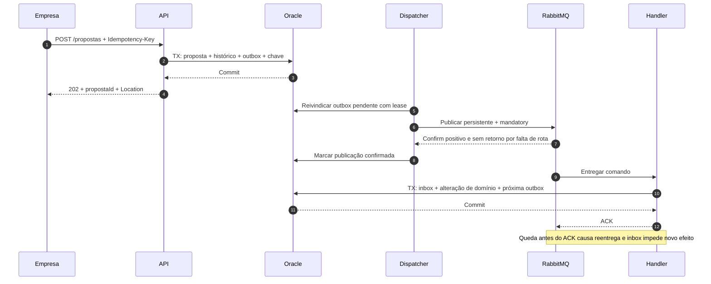
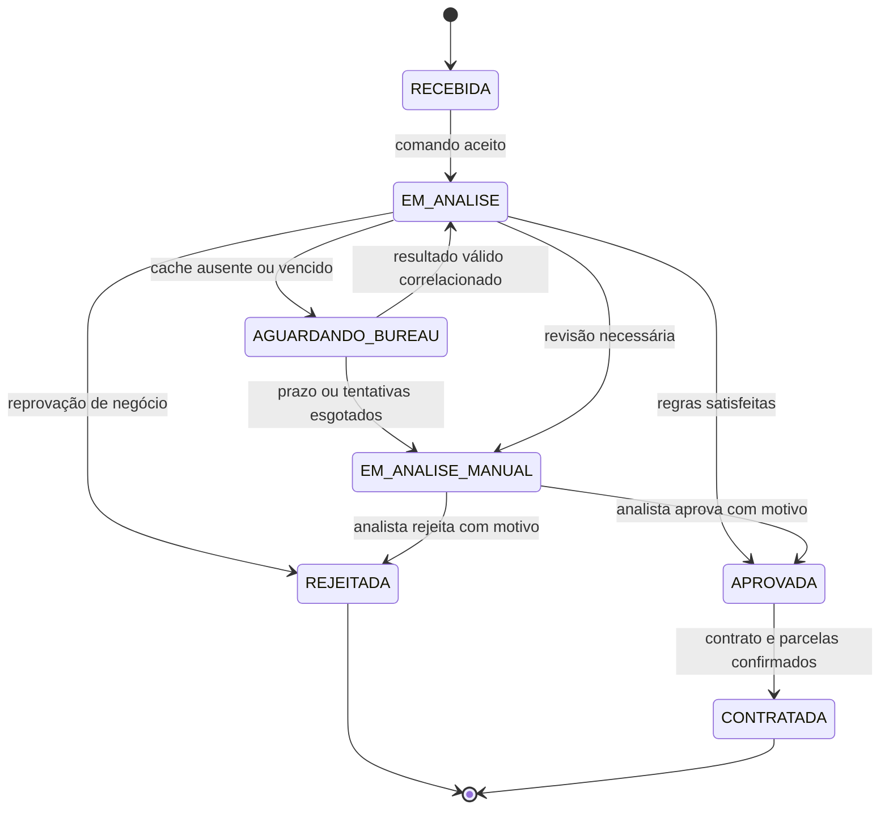

# PA-1 — Concessão de crédito assíncrona

Status: implementação incremental. M0 fornece fundação e M1 implementa cadastro, identidade, propostas idempotentes e gravação de histórico/outbox, conforme [evidências M1](../M1-VALIDACAO.md). Publicação, análise, decisão e contratos abaixo continuam sendo requisitos para os próximos marcos.

[Diagrama principal](pa-1.mmd) · [Escopo do produto](../../PROPOSTA.md)

## Decisões de base e limites

Adotar o **monólito modular .NET com uma API e um Worker**, conforme `PROPOSTA.md`. As caixas de processamento representam handlers e jobs do mesmo Worker. API e Worker compartilham os módulos e o Oracle; não há transação distribuída entre banco, RabbitMQ e bureau.

No diagrama, cada endpoint da concessão aparece em uma caixa própria: `POST /propostas`, `GET /propostas/{id}`, `POST /webhooks/bureau` e `POST /propostas/{id}/decisao-manual`. O GET apenas consulta dados autorizados; os endpoints de escrita persistem seus efeitos antes de responder. Handlers, jobs, exchange, filas e DLQs também aparecem separados por responsabilidade. Esses componentes continuam agrupados nos mesmos processos API e Worker.

Oracle substitui o PostgreSQL do desenho original para atender ao objetivo explícito de praticar Oracle e PL/SQL. Redis é somente cache. RabbitMQ transporta comandos e resultados, sem ser o registro oficial dos estados. Os módulos são Propostas, Crédito, Contratos, Pagamentos e Fechamento; cada módulo controla suas escritas, mesmo usando a mesma instância de banco.

O PA-1 cobre cadastro, análise, decisão e geração de contrato/parcelas. Pagamentos, conciliação e exportação diária continuam no escopo do produto, mas entram nas entregas seguintes, descritas ao final. Um contrato gerado não significa contrato assinado nem crédito desembolsado.

## Gaps encontrados e resoluções

| Gap no desenho original | Consequência | Resolução |
|---|---|---|
| PostgreSQL em uma proposta voltada a Oracle/PLSQL | Divergência com os objetivos e entregas | Oracle como fonte de verdade; packages e jobs financeiros nas entregas 4 e 5 |
| API publica na fila sem persistência explícita | Proposta perdida ou processamento sem registro | Proposta, histórico e outbox na mesma transação |
| Banco e broker sem protocolo de confirmação | Perda ou duplicação após falhas | Outbox, publisher confirms, `mandatory`, inbox e restrições de unicidade |
| Resultado do bureau chamado de proposta analisada | Bureau e motor de crédito confundidos | `fila-resultado-bureau`; somente o módulo Crédito decide |
| Webhook e polling independentes | Duas decisões ou sobrescrita por resultado antigo | Normalização comum, consulta correlacionada e transição concorrente protegida |
| Consulta sem agendamento e sem dono | Propostas pendentes indefinidamente | Pendência durável, lease, próxima tentativa e prazo máximo |
| Envio ao bureau sem recuperação de timeout | Consultas externas repetidas ou órfãs | Intenção persistida antes do HTTP e reconciliação por chave estável |
| Cache sem chave, validade ou fallback | Uso de risco de outro contexto ou travamento | Cache-aside com TTL, escopo e snapshot persistido |
| Apenas aprovação implícita | Rejeição e análise manual sem saída | Estados, motivos, versão de regras e endpoint de decisão manual |
| Contrato sem guarda de estado/unicidade | Dois contratos ou contrato de proposta rejeitada | Aprovação vigente, unicidade por proposta e criação atômica das parcelas |
| “DLQ nativa” genérica | Quarentena pode nem existir ou perder mensagens | DLX e quatro DLQs declaradas, políticas e replay controlado |
| Segurança, auditoria e operação ausentes | Acesso indevido e recuperação sem evidências | Autorização por empresa, autenticação de callback, trilha e métricas |
| Pagamentos e fechamento ausentes | Diagrama confundido com toda a plataforma | Limite do PA-1 explícito e sequência das entregas 4 a 6 preservada |

## Fluxo e fronteiras transacionais

1. `POST /propostas` autentica a empresa e valida os campos. Em uma transação Oracle, grava proposta, estado `RECEBIDA`, histórico, chave idempotente e comando `SolicitarAnalise` na outbox. Retorna `202 Accepted` com `propostaId` e `Location: /propostas/{id}` somente após commit. Se o commit falhar, a operação não é aceita.
2. O dispatcher reivindica registros da outbox com lease, publica no exchange e espera confirmação do broker. Somente marca como enviado quando houver confirm positivo e ausência de retorno por falta de rota. Timeout, nack ou retorno mantêm a pendência para nova tentativa. Uma falha após a publicação e antes da marcação pode duplicar a entrega.
3. O handler de análise deduplica o comando e fixa o snapshot da proposta e a versão das regras. Cache de risco válido produz `ResultadoBureauRecebido`, associado a uma consulta local concluída com origem `CACHE`; cache ausente produz `SolicitarBureau` e muda a proposta para `AGUARDANDO_BUREAU`. A transação grava estado, consulta/snapshot quando aplicável, inbox e outbox; o ACK vem depois do commit. Reentrega não muda a versão de regras nem inicia uma nova análise.
4. O handler de solicitação ao bureau grava uma intenção `PRONTA_ENVIO` com `consultaId`, chave externa, prazo e snapshot de entrada, junto da inbox. Então confirma a mensagem. O job de integração reivindica essa intenção e faz HTTP **fora da transação Oracle**. A intenção é suficiente para recuperar uma queda entre o ACK e a chamada externa.
5. A resposta de submissão grava o identificador do provedor e o próximo instante de consulta. Resposta final síncrona, webhook e polling usam a mesma normalização: resultado validado, correlação, snapshot imutável e comando `ResultadoBureauRecebido` na outbox em uma transação. O webhook retorna `2xx` após essa gravação; duplicata já persistida também recebe `2xx`. Banco indisponível retorna erro para permitir reenvio.
6. O motor consome o resultado, verifica consulta e versão vigentes e executa as regras determinísticas. Na mesma transação grava decisão, motivos, dados utilizados, histórico, inbox e, **somente se aprovada**, `GerarContrato` na outbox. Rejeição e análise manual não geram contrato.
7. O analista consulta as propostas em `EM_ANALISE_MANUAL` e envia uma decisão motivada. O módulo Crédito aplica a mesma guarda de estado/versão e auditoria do motor. Aprovação manual também grava `GerarContrato` na mesma transação; repetição não cria outra decisão.
8. O handler de contrato verifica aprovação vigente, grava contrato único por proposta, parcelas e inbox na mesma transação. Marca a proposta como `CONTRATADA`. Falha em qualquer parcela desfaz a operação inteira. Geração de PDF, assinatura e desembolso ficam para uma evolução específica.

O uso de outbox para resolver a escrita em dois sistemas e a necessidade de consumidores idempotentes seguem o [padrão transactional outbox](https://docs.aws.amazon.com/prescriptive-guidance/latest/cloud-design-patterns/transactional-outbox.html). Confirm de publicação e ACK de consumo são confirmações distintas, conforme a [documentação do RabbitMQ](https://www.rabbitmq.com/docs/confirms). A garantia pretendida é entrega pelo menos uma vez com efeitos idempotentes.

## Contratos de entrada, dados e concorrência

| Interface / registro | Contrato mínimo |
|---|---|
| Cadastro de empresas | `POST /empresas` idempotente por administrador autorizado e `GET /empresas/{id}` no escopo permitido; CNPJ validado e único por cadastro; vínculo entre identidade e empresa estabelecido antes do envio de propostas |
| `POST /propostas` | `Idempotency-Key` obrigatória, CNPJ correspondente à empresa cadastrada, faturamento e valor positivos, prazo e moeda suportados; empresa derivada da identidade autenticada |
| Idempotência HTTP | `UNIQUE(empresaId, operacao, chave)` e hash canônico do corpo; mesmo corpo retorna o mesmo ID e resposta de aceitação; corpo diferente com a mesma chave retorna `409` |
| `GET /propostas/{id}` | Autorização por empresa; estado atual, motivos, data da decisão e situação operacional; sem expor dados brutos do bureau |
| `POST /propostas/{id}/decisao-manual` | Papel de analista, decisão, motivos e versão esperada obrigatórios; guarda otimista e chave idempotente; conflito retorna `409` |
| Envelope de mensagem v1 | `messageId` lógico estável, `type`, `schemaVersion`, `propostaId`, `analiseId`, `correlationId`, `causationId`, `occurredAt` UTC, `traceparent`, `attempt`, `replayId` e payload mínimo |
| Inbox | `UNIQUE(consumer, messageId)`; registro concluído junto do efeito de domínio ou da intenção durável que será retomada por job |
| Outbox | `outboxId` único por publicação agendada, `messageId` lógico, tipo, rota, payload, `attempt`, `replayId`, `availableAt`, `leaseUntil`, token de lease, `publishedAt` e erro; alterações exigem o token vigente |
| Consulta externa | `consultaId`, `analiseId`, provedor, chave externa, `providerRequestId`, estado, `nextAttemptAt`, `deadlineAt`, tentativa e token de lease |
| Resultado | Provedor, consulta, versão/identificador do resultado, instante de obtenção, validade e snapshot; mesmo identificador com conteúdo divergente vai para investigação |
| Decisão | Proposta, análise, snapshot usado, versão das regras, resultado, motivos e autor; `UNIQUE(analiseId)` para a decisão final; encaminhamento manual é histórico, não uma decisão final adicional |
| Contrato | `UNIQUE(propostaId)` e parcelas com `UNIQUE(contratoId, numero)`; valores decimais e regra de arredondamento documentada |

Manter os registros de idempotência pelo menos por toda a janela de repetição/replay suportada; arquivamento deve preservar as chaves de unicidade de efeitos financeiros. Retenção de snapshots, payloads e auditoria exige uma política de dados própria antes de uso real.

No webhook, validar credencial/assinatura e timestamp segundo o contrato do provedor, tamanho e schema antes de aceitar o payload. Deduplicar por `(provedor, eventId)` e, entre canais, por `(provedor, consultaId, versaoResultado)`. Se não houver versão externa, usar um identificador canônico do resultado e a guarda de finalização da consulta. Evento sem correlação válida fica em quarentena durável e gera alerta; não cria uma proposta. A chave externa é criada antes da submissão para correlacionar callbacks que chegam antes da resposta HTTP. Se o provedor devolver somente seu próprio ID, guardar temporariamente o callback e reconciliar depois da submissão.

Não confiar na ordem das filas. Usar atualização condicional por estado e versão da proposta/análise. Resultado de uma consulta anterior ou de proposta finalizada é auditado e descartado para decisão. Webhook e polling concorrentes disputam a mesma finalização; o perdedor não gera uma segunda outbox. Resultados finais conflitantes são investigados, sem substituir uma decisão já tomada. Verificar também a validade do risco no instante da decisão: se venceu durante a espera na fila, agendar uma nova consulta com novo `consultaId`, mantendo a versão das regras; se o prazo total da análise acabou, encaminhar para análise manual.

As três regras iniciais são determinísticas e configuradas por versão: comprometimento máximo da receita, teto de endividamento e limite disponível. Fórmula de parcela, percentuais e fontes dos dados são fixtures explícitas do simulador; não representam política de concessão real. Se o limite for compartilhado por várias propostas da empresa, reservar o valor com concorrência protegida na transação de aprovação, impedindo aprovações simultâneas acima do limite.

## Estados e recuperação

Indisponibilidade técnica não significa rejeição de crédito. Erros operacionais, tentativas e quarentena são registrados separadamente do estado de negócio. Uma proposta `APROVADA` com contrato pendente permanece aprovada, com erro operacional visível. Mensagem em DLQ não encerra a proposta silenciosamente: o monitor identifica a etapa travada e abre pendência de recuperação. Se a mensagem estiver ilegível e não permitir correlação, o monitor de idade do estado encontra a proposta parada no banco.

No PA-1, decisões finais não são reabertas. Uma nova avaliação exige uma nova proposta, vinculada à anterior para auditoria. Propostas aprovadas não expiram automaticamente enquanto houver comando de contrato em trânsito; cancelamento, expiração e liberação de reservas precisam de um protocolo próprio antes de serem adicionados.

### Bureau: envio, polling e cache

O reconciliador varre pendências no Oracle com índice em estado e `nextAttemptAt`, reivindica lotes com lease e token de versão e retoma intenções `PRONTA_ENVIO`, submissões incertas e consultas em andamento. Instâncias concorrentes não devem atualizar uma pendência com token vencido. A correção continua dependendo das chaves idempotentes, pois uma chamada externa pode terminar depois de um lease expirar.

Após timeout de submissão, consultar primeiro pela chave externa; repetir o POST apenas com a mesma chave e quando o provedor garantir idempotência. Sem idempotência nem consulta por chave, marcar submissão incerta para investigação manual: não é possível garantir uma única consulta externa. Esse é um requisito do contrato do simulador e uma condição de integração com um bureau real.

Timeout HTTP inicial: 5 s. Polling inicial: 30 s entre consultas, com jitter, respeito a `Retry-After` e prazo total de 15 min por análise. Valores são parâmetros para o laboratório, ajustáveis após medição. O prazo esgotado encaminha para análise manual com motivo técnico; resultado tardio não decide automaticamente uma proposta que já saiu de `AGUARDANDO_BUREAU`.

Cache-aside: chave com empresa, documento normalizado protegido por hash com chave, provedor, produto e versão do contexto da consulta; TTL inicial de 5 min, nunca maior que a validade informada pelo bureau. Armazenar somente risco concluído, não timeout ou pendência. Resultado reutilizado precisa cobrir todos os dados de entrada relevantes. Em hit, persistir o snapshot e a origem `CACHE` antes da decisão. Em miss/Redis indisponível, seguir a consulta externa; falha de escrita no cache não impede o fluxo. Atualizar o cache após persistir o resultado, como melhor esforço. Evitar consultas simultâneas iguais por unicidade/lease no banco; lock Redis não sustenta invariantes.

## RabbitMQ, retries e quarentena

Usar o exchange direct durável `proposta-credito.credito.v1` e as filas abaixo, com mensagens persistentes e consumidores de ACK manual. Nomes preservados do desenho original, exceto a fila que confundia resultado de risco com decisão de crédito.

| Routing key | Fila principal | Consumidor | DLQ |
|---|---|---|---|
| `analise.solicitar` | `fila-solicitacao-analise` | Preparar análise | `fila-solicitacao-analise.dlq` |
| `bureau.solicitar` | `fila-solicitacao-bureau` | Registrar intenção de consulta | `fila-solicitacao-bureau.dlq` |
| `bureau.resultado` | `fila-resultado-bureau` | Motor de decisão | `fila-resultado-bureau.dlq` |
| `contrato.gerar` | `fila-solicitacao-contrato` | Gerar contrato e parcelas | `fila-solicitacao-contrato.dlq` |

Declarar `proposta-credito.credito.dlx.v1` como exchange direct. Cada fila principal usa policy com `dead-letter-exchange` e `dead-letter-routing-key` igual ao seu nome; a DLQ correspondente é ligada a essa chave. DLQ não retorna automaticamente à fila de origem. Verificar exchanges, filas, bindings e permissões no provisionamento e na prontidão do dispatcher. DLQ requer configuração explícita, conforme a [documentação de dead-letter exchanges](https://www.rabbitmq.com/docs/dlx).

Filas principais e DLQs são quorum. No laboratório, um nó com persistência em disco serve ao exercício, sem alta disponibilidade; uma implantação que exija tolerância à perda de nó precisa de três membros em domínios de falha separados. Configurar nas filas de origem `dead-letter-strategy=at-least-once`, `overflow=reject-publish`, DLX e limites de tamanho/entrega. Fixar e validar uma versão do RabbitMQ que suporte essas políticas. Essa proteção exige configuração: quorum sozinho não torna o dead-lettering confiável. Ver [garantias e pré-requisitos das quorum queues](https://www.rabbitmq.com/docs/quorum-queues#dead-lettering).

Política de recuperação escolhida para o PA-1:

- Falha transitória de um handler: desfazer efeitos incompletos e, em uma transação própria, persistir retry na outbox com a mesma identidade lógica e tentativa incrementada; só então ACK. Não marcar a inbox como concluída antes do sucesso. Retry disponível em 5 s, 30 s e 2 min, com jitter; depois da quarta execução malsucedida, quarentena. Unicidade `(consumer, messageId, replayId, attempt)`, com `replayId` inicial explícito e não nulo, evita dois agendamentos para a mesma tentativa. O controle de execução persistido descarta tentativas antigas já reagendadas e serializa concorrentes; inbox concluída bloqueia qualquer tentativa posterior.
- O dispatcher respeita `availableAt`; por isso não são necessárias filas de TTL ou plugin de atraso. Falha de publicação mantém a outbox pendente, com backoff e alerta por idade; não descarta o evento ao atingir um contador.
- Se nem o retry puder ser persistido, não dar ACK. Pausar consumo e reconectar com backoff para recuperar entregas; não entrar em loop de `nack(requeue=true)`. Limite de entregas do broker protege contra crashes repetidos, mas não substitui o contador de tentativas de negócio.
- Mensagem com schema inválido, versão não suportada ou tentativas esgotadas: `nack(requeue=false)` para a DLQ configurada. Para erros correlacionáveis, gravar antes a falha operacional; se houver queda antes do nack, a reentrega retoma a quarentena. Validação negativa de crédito é uma decisão normal, nunca DLQ.
- As tentativas HTTP/polling pertencem à intenção de consulta no banco, após ACK do comando de submissão; usam prazo e agendamento próprios. Não multiplicar retries de fila por retries HTTP ocultos.
- Replay é uma operação administrativa autorizada: inspecionar causa, corrigir, registrar operador/motivo, publicar pela outbox na rota original e confirmar antes de retirar da DLQ. Preservar `messageId`, `propostaId` e `analiseId`, adicionar `replayId` e reiniciar o orçamento de tentativas em uma trilha de replay distinta. Inbox concluída continua impedindo novo efeito; mensagem defeituosa que precise de outro payload exige comando corrigido com novo ID e vínculo à original.

Leases curtos e renováveis, prefetch e concorrência limitados evitam sobrecarga. Aplicar circuit breaker e limites por provedor; escalar handlers conforme idade da fila, capacidade do Oracle e limites do bureau. Não manter locks do banco durante chamadas HTTP.

## Segurança, observabilidade e operação

API valida identidade e escopo em todas as operações; o cliente não pode selecionar livremente a empresa. Análise manual e replay exigem papéis próprios e trilha de auditoria; analistas só acessam empresas de sua carteira autorizada. Credenciais do bureau, Oracle e RabbitMQ ficam fora de arquivos versionados, com identidades de serviço e privilégios mínimos. Usar TLS nas conexões e proteção de dados em repouso nas implantações reais. O simulador utiliza dados fictícios.

Propagar `correlationId`/`traceparent` entre HTTP, outbox, filas e jobs. Logs estruturados registram etapa, IDs técnicos, tentativa e erro sanitizado, sem CNPJ, faturamento ou payload bruto do bureau. Histórico de negócio e auditoria ficam no Oracle; Datadog agrega telemetria e não substitui esse histórico.

Métricas mínimas: idade da outbox mais antiga, mensagens sem rota, nacks/confirms, tamanho e idade por fila, DLQ, duração da decisão, estados sem progresso, consultas incertas, taxa de timeout, latência do bureau, hit/miss do cache e contratos pendentes. ID de proposta fica em logs/traces, não como label de métrica de alta cardinalidade.

Metas iniciais do laboratório, ainda não comprovadas: aceitação p95 abaixo de 500 ms com banco saudável e decisão automática em até 2 min para 95% das propostas quando o bureau responde em até 30 s e não há backlog. Alertar com DLQ maior que zero, outbox sem publicação por mais de 1 min, contrato pendente por mais de 5 min ou consulta além de 15 min. Falha de negócio e análise manual ficam fora da meta de decisão automática, com idade acompanhada separadamente.

Prontidão HTTP depende de acesso ao Oracle e migrations compatíveis. Uma indisponibilidade do broker permite aceitar propostas já persistidas para publicação posterior enquanto a capacidade da outbox estiver dentro do limite operacional; ao excedê-lo, rejeitar novas entradas com `503` antes de criar a proposta. Redis e bureau indisponíveis não tornam o processo morto. Worker informa separadamente prontidão para consumo/publicação e saúde dos jobs; liveness não depende de serviços externos.

Antes de uso real, definir volume, concorrência, disponibilidade, retenção, RPO/RTO e testar restauração de backup do Oracle e perda de nó do broker. Não há evidência no repositório para prometer capacidade ou disponibilidade de produção.

## Entregas seguintes da plataforma

| Entrega | Componentes e invariantes a acrescentar |
|---|---|
| 4 — Pagamentos | Ingresso autenticado, recibo durável e outbox; fila de pagamentos; `UNIQUE(provedor, pagamentoExternoId)` e verificação de conteúdo; package PL/SQL aplica alocação parcial, lançamentos e saldo na mesma transação. Duplicata não baixa duas vezes; estorno é lançamento compensatório. Notificação sem parcela correlacionada vira pendência de conciliação. |
| 5 — Fechamento | Job Oracle/PLSQL por data contábil com lease/execução única, identificação de atraso, conciliação e versão do fechamento. Totais e divergências persistidos; reexecução não duplica lançamentos. Gerar arquivo de snapshot confirmado com manifesto/checksum e publicação atômica em armazenamento durável. Pagamentos tardios geram ajuste rastreável. |
| 6 — Qualidade e suporte | Pipeline com build, testes, migrations versionadas de schema/packages, análise Sonar e cenários de falha. Dashboards Datadog e runbooks de DLQ, submissão incerta e pagamento não baixado. Jira e Zendesk organizam trabalho e chamados, sem dependência no processamento de crédito. |

Regras de concessão ficam no módulo Crédito; PL/SQL concentra invariantes financeiras transacionais e rotinas de fechamento. Triggers de auditoria devem ser restritas à trilha de alterações, sem publicar no broker nem duplicar regras de negócio. Cada transação tem um proprietário; procedures não fazem commits parciais que quebrem a atomicidade de inbox, outbox e domínio.

## Cenários de aceite da implementação

Estes cenários são critérios para testes futuros; não foram executados porque ainda não há aplicação.

| Cenário | Resultado obrigatório |
|---|---|
| Duas requisições simultâneas com a mesma chave HTTP | Uma proposta e um comando; mesmo ID retornado. Corpo divergente retorna `409`. |
| Banco falha antes do commit de criação | Nenhuma proposta aceita e nenhuma publicação. |
| Broker indisponível depois do commit | Proposta consultável e outbox pendente; recuperação publica sem intervenção no domínio. |
| Publicação confirmada e dispatcher cai antes de marcar outbox | Pode haver reentrega; só uma intenção/decisão/contrato efetivo. |
| Consumer cai antes do ACK, após commit | Inbox reconhece duplicata e devolve ACK sem repetir efeito. |
| Comando de bureau confirmado e Worker cai antes do HTTP | Job retoma a intenção durável. |
| Bureau aceita e a resposta HTTP se perde | Reconciliação usa a mesma chave; sem suporte do provedor, investigação manual. |
| Callback chega antes do retorno de submissão | Correlação pela chave externa ou quarentena temporária reconciliável. |
| Webhook e polling entregam resultado final juntos | Um snapshot aceito por versão e uma decisão final; conflito é auditado. |
| Redis indisponível ou risco vencido, inclusive após espera na fila | Fluxo continua via bureau ou análise manual se o prazo esgotou, sem decidir com dado vencido. |
| Resultado antigo chega depois da decisão manual | Decisão vigente e contrato não são alterados. |
| Duas aprovações concorrem pelo limite da empresa | Reserva transacional impede ultrapassar o limite. |
| Aprovação e rejeição manual concorrem na mesma versão | Só uma vence; a outra recebe conflito e não publica contrato. |
| Falha ao gerar uma das parcelas | Nenhum contrato parcial; retry não duplica contrato ou parcelas. |
| Mensagem inválida ou retries esgotados | DLQ correta, alerta e etapa operacional identificável. |
| DLQ indisponível | Origem retém mensagem com política de dead-lettering validada; alerta de acúmulo. |
| Replay após o efeito já ter sido confirmado | Auditoria de replay e nenhum novo efeito. |
| Empresa tenta consultar proposta de outra empresa | Acesso negado, sem exposição de dados. |

As decisões acima fecham os gaps da proposta documental. A execução desses testes, a escolha das versões e o dimensionamento fazem parte da implementação.
